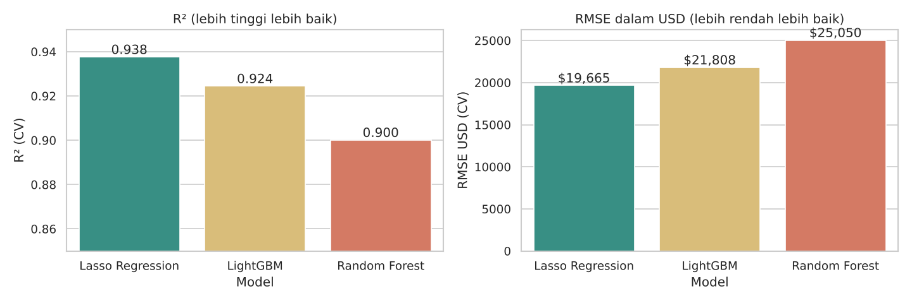
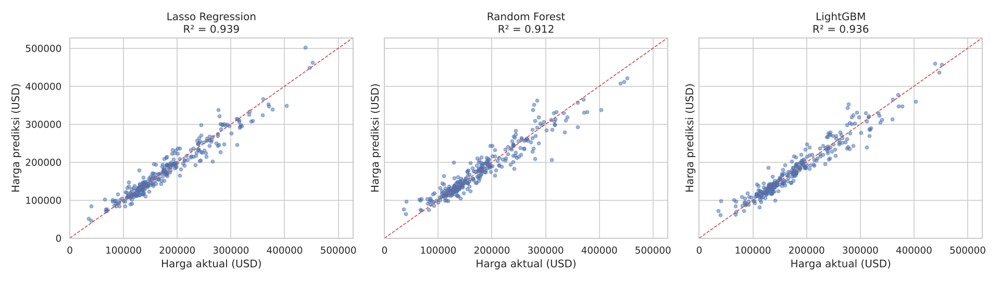
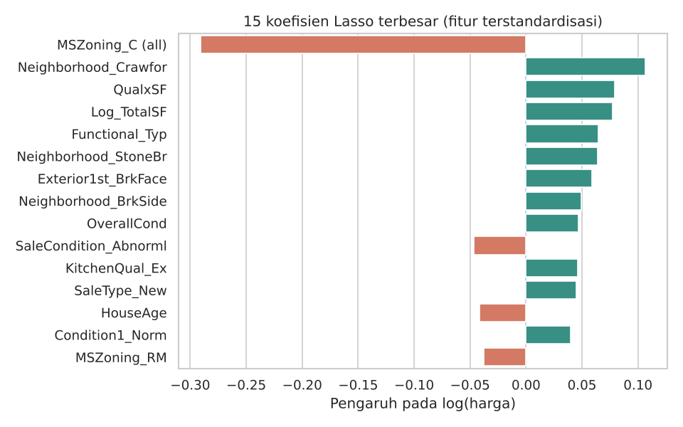
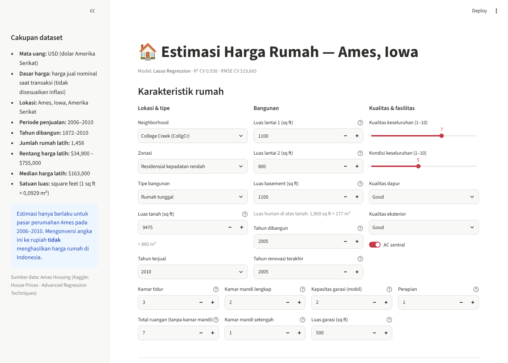

# 🏠 House Price Prediction — Ames, Iowa

[](https://house-price-xmartianz.streamlit.app/)

Membangun dan membandingkan tiga model regresi, yaitu **Lasso Regression**, **Random Forest**, dan **LightGBM**, untuk memprediksi harga jual rumah, lalu mengevaluasi performanya dengan **R²** dan **RMSE**. Pipeline preprocessing dan model terbaik disimpan sebagai satu artifact dan dipakai oleh demo interaktif.



## Tujuan proyek

1. Memahami faktor yang paling memengaruhi harga rumah.
2. Membandingkan model linear yang teregulasi (Lasso) dengan dua model berbasis pohon (Random Forest, LightGBM).
3. Memilih model terbaik secara objektif dengan cross-validation.
4. Menyediakan alur lengkap yang bisa direproduksi, dari membaca data sampai memprediksi harga satu rumah baru.

## Sumber data

**Ames Housing Dataset** dari kompetisi Kaggle [House Prices – Advanced Regression Techniques](https://www.kaggle.com/c/house-prices-advanced-regression-techniques), disusun oleh Dean De Cock (2011).

| | |
|---|---|
| Lokasi | Ames, Iowa, Amerika Serikat |
| Periode penjualan | 2006–2010 |
| `data/train.csv` | 1.460 rumah, 79 fitur + `SalePrice` (target) |
| `data/test.csv` | 1.459 rumah, tanpa `SalePrice` |
| Mata uang target | **USD**, harga nominal saat transaksi |
| Rentang harga latih | $34.900 – $755.000 (median $163.000) |
| Satuan luas | square feet (1 sq ft ≈ 0,0929 m²) |

Karena `test.csv` tidak memiliki label, evaluasi dilakukan pada `train.csv` dengan **5-fold cross-validation** dan **hold-out 80/20**. `test.csv` hanya dipakai untuk menghasilkan `submission.csv`.

## Struktur proyek

```
house-price-prediction/
├── house_price_prediction.ipynb   # alur lengkap: EDA → model → artifact → prediksi
├── house_features.py              # feature engineering & preprocessing (dipakai notebook dan demo)
├── app.py                         # demo interaktif (Streamlit)
├── models/
│   └── house_price_pipeline.joblib  # artifact: pipeline preprocessing + model + metadata
├── data/
│   ├── train.csv
│   └── test.csv
├── images/                        # grafik untuk README
├── submission.csv                 # prediksi untuk test.csv
├── requirements.txt
└── README.md
```

## Cara menjalankan

```bash
git clone https://github.com/xMartianz/house-price-prediction.git
cd house-price-prediction
python -m venv .venv
source .venv/bin/activate        # Windows: .venv\Scripts\activate
pip install -r requirements.txt
```

**Notebook** (melatih ulang model dan membuat ulang artifact):

```bash
jupyter notebook house_price_prediction.ipynb
```

Lalu pilih *Run All*. Proses selesai dalam ±1 menit di laptop biasa.

**Demo interaktif**:

```bash
streamlit run app.py
```

Buka `http://localhost:8501`. Diuji dengan Python 3.13. Python ≥ 3.10 seharusnya juga bisa.

## Metodologi

1. **EDA**: distribusi harga condong ke kanan (skew 1,88), jadi model dilatih pada `log(1 + SalePrice)`.
2. **Pembersihan**: 2 outlier dibuang (luas > 4.000 sq ft tetapi harga < $300.000), sesuai rekomendasi penyusun dataset.
3. **Preprocessing** (`house_features.py`, semuanya di dalam satu `sklearn.Pipeline`):
   - `NaN` yang berarti "tidak ada fasilitas" (garasi, basement, kolam, dll.) diisi `"None"`.
   - Fitur baru: `TotalSF`, `TotalBath`, `HouseAge`, `YearsSinceRemod`, `QualxSF`, skor ordinal kualitas, flag `Has*`, serta log dari fitur luas.
   - Numerik: imputasi median + standardisasi. Kategorikal: imputasi modus + one-hot encoding.
4. **Model**: dibungkus `TransformedTargetRegressor`, sehingga dilatih dalam skala log tetapi memprediksi langsung dalam USD.
5. **Evaluasi**: R², RMSE (USD), dan RMSE log (metrik Kaggle).

## Hasil

**5-fold cross-validation** (1.458 rumah):

| Model | R² | RMSE (USD) | RMSE log |
|---|---|---|---|
| **Lasso Regression** | **0,938 ± 0,012** | **$19.665 ± 1.683** | **0,109** |
| LightGBM | 0,925 ± 0,008 | $21.808 ± 2.206 | 0,116 |
| Random Forest | 0,900 ± 0,007 | $25.050 ± 1.865 | 0,130 |

**Hold-out 80/20** (292 rumah yang tidak dipakai saat pelatihan):

| Model | R² | RMSE (USD) | MAPE |
|---|---|---|---|
| **Lasso Regression** | **0,939** | **$18.298** | **7,9%** |
| LightGBM | 0,936 | $18.874 | 8,6% |
| Random Forest | 0,912 | $22.051 | 9,7% |



## Model terpilih: Lasso Regression

Lasso unggul di kedua skema evaluasi. RMSE-nya sekitar 11% dari median harga, waktu latihnya paling singkat (< 0,3 detik), dan koefisiennya bisa diinterpretasi langsung. Penalti L1 hanya mempertahankan 116 dari 327 fitur. Setelah log-transform dan feature engineering, hubungan harga dengan luas, kualitas, dan umur rumah cukup linear, dan dengan ~1.460 baris model linear yang teregulasi lebih stabil daripada model pohon.



Penentu harga terkuat adalah total luas × kualitas (`QualxSF`), total luas, dan lokasi (Crawford, Stone Brook naik; zona komersial turun sekitar 25%). Umur rumah dan penjualan *abnormal* menurunkan harga.

## Demo interaktif

**Coba langsung:** https://house-price-xmartianz.streamlit.app/ (kalau app sedang "tertidur", klik tombol untuk membangunkannya, sekitar 30 detik).

`app.py` memuat **satu artifact** (`models/house_price_pipeline.joblib`) yang berisi:

- `pipeline`: feature engineering → imputasi → scaling/one-hot → Lasso → konversi log ke USD
- `metadata`: mata uang, cakupan dataset, metrik, nilai default rumah tipikal, dan rentang fitur

Dengan begitu, input rumah baru diproses **persis sama** seperti saat pelatihan. Demo menampilkan:

- estimasi harga dalam **USD** dengan rentang ± 1 RMSE dan posisi persentil terhadap data latih
- panel **cakupan dataset** (lokasi, periode 2006–2010, rentang harga, satuan luas)
- **peringatan** jika input berada di luar rentang data latih
- baris data lengkap yang dikirim ke pipeline (untuk transparansi)

Fitur yang tidak ditanyakan di form diisi nilai rumah tipikal (median/modus) dari data latih.



## Keterbatasan

- **Cakupan geografis & waktu sempit**: hanya satu kota kecil di AS pada 2006–2010, termasuk masa krisis perumahan 2008. Model tidak berlaku untuk kota lain, negara lain (termasuk Indonesia), atau harga saat ini.
- **Harga nominal**: tidak disesuaikan inflasi. Mengonversi hasil ke rupiah tidak menghasilkan harga properti yang realistis.
- **Ukuran data kecil** (~1.460 rumah): beberapa neighborhood dan kategori langka hanya punya sedikit contoh, sehingga estimasinya kurang andal.
- **Ekstrapolasi**: rumah yang sangat besar atau sangat mahal di luar rentang latih bisa salah besar. Contohnya, satu rumah di `test.csv` (Id 2550, luas hunian 5.095 sq ft) diprediksi > $1,3 juta, hampir dua kali harga tertinggi di data latih.
- **Outlier dibuang** sebelum evaluasi, jadi metrik tidak mencerminkan performa pada penjualan tidak wajar (`Partial`/`Abnorml` ekstrem).
- **Hyperparameter belum di-tuning secara sistematis**. LightGBM berpotensi menyusul dengan tuning (Optuna/GridSearch) atau ensembling.
- **Default rumah tipikal di demo**: input yang tidak ditanyakan (misalnya kualitas basement atau tipe atap) diasumsikan rata-rata, sehingga estimasi untuk rumah yang tidak biasa bisa meleset.
- **Rentang ± RMSE** hanya perkiraan kasar, bukan interval prediksi statistik.

## Teknologi

Python · pandas · NumPy · scikit-learn · LightGBM · Matplotlib · seaborn · joblib · Streamlit
